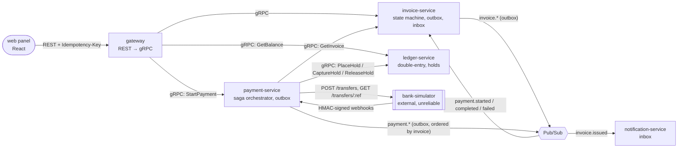

# Ledgerly

A learning project: a small fintech-style backend where invoices are paid through a double-entry ledger and an
**unreliable external bank**. It was built to reproduce typical distributed-systems failures on purpose, name them,
and fix them.

Every problem below follows the same loop: a **naive implementation**, a **script that reproduces the failure** with
concrete numbers, then a **fix**, checked with the same script. The full write-ups (root cause, fix, trade-offs) are in
[`docs/journal.md`](docs/journal.md).

> This is not a product. It favours clarity over completeness: plain SQL, no ORM entities, minimal abstractions.

**Stack:** Node.js 24, TypeScript (strict), NestJS, gRPC (`ts-proto`), PostgreSQL 16 (database per service),
Google Cloud Pub/Sub (local emulator), zod, React + TanStack Query + Vite, Docker Compose, pnpm workspaces.

## Architecture



| Service                | Responsibility                                                                         | Interface                   | Database        |
| ---------------------- | -------------------------------------------------------------------------------------- | --------------------------- | --------------- |
| `web`                  | React panel: account balance, create / issue / pay invoices, live statuses (polling)   | Vite :5173 → gateway        | –               |
| `gateway`              | public REST API (BFF), gRPC → HTTP error mapping, required `Idempotency-Key`           | REST :3000 → gRPC           | –               |
| `ledger-service`       | accounts, double-entry transactions, balances, holds (available vs held)               | gRPC :50051                 | `ledger`        |
| `invoice-service`      | invoices + state machine `DRAFT → ISSUED → PAYMENT_PENDING → PAID`, reacts to payments | gRPC :50052                 | `invoices`      |
| `notification-service` | consumes `invoice.*` events, idempotent consumer                                       | Pub/Sub                     | `notifications` |
| `payment-service`      | orchestrated "pay" saga, bank webhooks, sweeper, publishes `payment.*`                 | gRPC :50053, HTTP :3100     | `payments`      |
| `bank-simulator`       | a fake external bank with chaos switches                                               | REST :4000, webhooks → 3100 | in memory       |

Each service has its own database and DB user with no access to other databases, so there are no cross-service
foreign keys. Contracts live in shared packages: `packages/proto` (gRPC) and `packages/events` (zod event schemas with
`schemaVersion`).

## Problems reproduced and fixed

| #   | Problem (EN name)                                                            | Reproduction                                                                       | Naive result                                                                       | Fix                                                                                                                                               |
| --- | ---------------------------------------------------------------------------- | ---------------------------------------------------------------------------------- | ---------------------------------------------------------------------------------- | ------------------------------------------------------------------------------------------------------------------------------------------------- |
| 1   | **Race condition / double spend** (check-then-act)                           | `scripts/race-place-hold.ts`: 50 parallel 10 PLN holds on a 100 PLN account        | 18 holds approved, available **−80 PLN**                                           | `SELECT … FOR UPDATE` + `CHECK (balance - held >= 0)` added as `NOT VALID` + `VALIDATE` → exactly 10 holds                                        |
| 2   | **Duplicate submission** (double click, retry after timeout)                 | `scripts/double-submit-invoice.ts`                                                 | 2 invoices per user action                                                         | client-generated `Idempotency-Key`, stored with the request hash and response **in the same transaction** as the invoice                          |
| 3   | **Dual write → lost event**                                                  | `scripts/lost-event.ts` with `CRASH_AFTER_COMMIT=true`                             | invoice ISSUED, **0 notifications**, even after a client retry                     | **transactional outbox** + polling relay with `FOR UPDATE SKIP LOCKED` (2 instances, 300 events: 146/154 split, 0 duplicates)                     |
| 4   | **Duplicate delivery** (at-least-once)                                       | `scripts/duplicate-delivery.ts` with `CRASH_AFTER_PUBLISH=true`                    | 2 notifications for 1 event                                                        | **inbox** (`processed_events`, PK on `event_id`) in the same transaction as the side effect; ack only after commit                                |
| 5   | **Timeout with an unknown outcome**                                          | `scripts/payment-saga.ts` (IBAN `TT…`, bank stores the transfer but never answers) | payment FAILED, hold released, **bank SETTLED** → money sent, customer not charged | timeout → `BANK_UNKNOWN`, then query the bank by our idempotent `reference`; never compensate on a timeout                                        |
| 6   | **Partial failure** (no compensation)                                        | `scripts/payment-saga.ts` (IBAN `XX…`, bank rejects)                               | payment FAILED, **123 PLN held forever**                                           | compensating action `ReleaseHold`, `COMPENSATING` persisted first, deterministic idempotency key per saga step                                    |
| 7   | **Out-of-order / duplicate webhooks**, webhook faster than the HTTP response | `REORDER_WEBHOOKS=true DUPLICATE_WEBHOOK_RATE=1`                                   | capture vs release race, 500 for a successful payment                              | webhook = notification only, then **fetch the current status**; one decision table `(our status × bank status) → action`; compare-and-set updates |
| 8   | **Stuck saga**                                                               | `scripts/stuck-saga.ts` with `CRASH_AFTER_BANK_CALL=true`                          | FUNDS_HELD forever while the bank says SETTLED                                     | `POST /sweep` reconciles sagas untouched for N seconds                                                                                            |
| 9   | **Paying the same invoice twice** (two tabs, two different idempotency keys) | two parallel `POST /invoices/:id/pay`                                              | –                                                                                  | partial **unique index**: one non-FAILED payment per invoice → second request 409                                                                 |
| 10  | **Eventual consistency in the UI**                                           | web panel                                                                          | payment COMPLETED while the invoice still shows PAYMENT_PENDING                    | intermediate statuses + polling until a final state (TanStack Query `refetchInterval`)                                                            |
| 11  | **Forged / replayed webhooks**                                               | unit tests                                                                         | –                                                                                  | HMAC-SHA256 over `timestamp.rawBody`, ±5 min window, constant-time comparison                                                                     |

Observed along the way, and also described in the journal: a **poison message** (139 redeliveries in a few seconds of
a message the consumer could never parse), a **contract mismatch** (producer and consumer validated UUIDs differently),
and **duplicate package instances** in the monorepo breaking NestJS dependency injection.

## Design decisions worth looking at

- **Money:** `bigint` in minor units + currency code, never floats. Ledger entries are immutable; a correction is a
  new entry.
- **Idempotency everywhere:**
  - keys are generated by the client once per user intent;
  - inside the saga they are **derived deterministically** (`payment:<id>:<step>`), so a crashed orchestrator
    recomputes the same key;
  - keys are stored atomically with the side effect.
- **State machines as transition tables:**
  - invoices: [`invoice-state.ts`](services/invoice-service/src/invoices/domain/invoice-state.ts);
  - payment saga: [`payment-decision.ts`](services/payment-service/src/payments/domain/payment-decision.ts).
  - Status changes are compare-and-set (`UPDATE … WHERE status = <status I read>`).
- **Orchestrated saga** with durable state in the `payments` table, chosen over choreography because a money flow
  needs compensation and timeout handling in one place. The invoice only _reacts_ to `payment.*` events
  (choreography where it's cheap), published with the invoice id as ordering key.
- **At-least-once + idempotent consumers = effectively-once.** Exactly-once delivery is not assumed anywhere.

## Running locally

Requirements: Node.js 24 (`.nvmrc`), pnpm (`corepack enable`), Docker.

The database passwords and the webhook secret in this repository are local-development defaults for the Docker
setup; every service reads them from environment variables, which a real deployment sets (e.g. from Secret Manager).

```bash
pnpm bootstrap   # install, start Postgres + Pub/Sub emulator, build, run all migrations, create topics
pnpm dev         # every service + the web panel in watch mode
pnpm seed        # (once, with services running) demo account with 1000.00 PLN for the web panel
pnpm test        # unit tests
```

### Windows

Docker Desktop needs WSL 2 (`wsl --install` in an administrator PowerShell, then reboot). pnpm runs package scripts
with `cmd.exe` on Windows, so the scripts that rely on POSIX shell syntax have a `:win` twin:

| macOS / Linux             | Windows                       |
| ------------------------- | ----------------------------- |
| `pnpm dev`                | `pnpm dev:win`                |
| `pnpm check:db-isolation` | `pnpm check:db-isolation:win` |
| `pnpm infra:errors`       | `pnpm infra:errors:win`       |

Everything else (`bootstrap`, `build`, `migrate`, `seed`, `test`, the `node scripts/*.ts` reproductions) works as is.
Chaos switches are set the PowerShell way, e.g. `$env:CRASH_AFTER_COMMIT='true'; pnpm --filter invoice-service start`
(and `Remove-Item Env:CRASH_AFTER_COMMIT` afterwards).

Open <http://localhost:5173>, create an invoice, issue it and pay it. The IBAN presets choose how the bank behaves
(accept / reject / time out), so every saga path can be clicked through. Or run any reproduction script, e.g.
`node scripts/payment-saga.ts`; each script's header says which services and chaos switches it needs.

### Chaos switches (environment variables)

| Service           | Variable                                                         | Effect                                                               |
| ----------------- | ---------------------------------------------------------------- | -------------------------------------------------------------------- |
| `bank-simulator`  | `FAIL_RATE`, `TIMEOUT_RATE`, `REJECT_RATE`                       | 500 before storing / store but never answer / reject later (0..1)    |
| `bank-simulator`  | `DUPLICATE_WEBHOOK_RATE`, `REORDER_WEBHOOKS`, `WEBHOOK_DELAY_MS` | duplicated, reordered or delayed webhooks                            |
| `bank-simulator`  | IBAN starting with `XX` / `TT`                                   | deterministic reject / timeout (used by the scripts)                 |
| `invoice-service` | `CRASH_AFTER_COMMIT`, `CRASH_AFTER_PUBLISH`                      | die after the DB commit / after publishing, before marking published |
| `payment-service` | `CRASH_AFTER_BANK_CALL`                                          | die after the bank accepted the transfer, before saving it           |

## Repository layout

```
apps/web/      React panel (Vite, TanStack Query)
services/      gateway, ledger-service, invoice-service, notification-service, payment-service, bank-simulator
packages/      proto (gRPC contracts + generated types), events (zod event schemas),
               common (SQL helper, idempotency, inbox, outbox + relay: framework-free, see below)
scripts/       reproduction scripts, one per problem
infra/         docker-compose (Postgres 16, Pub/Sub emulator) + per-service DB users
docs/          journal.md — one entry per stage: problem, reproduction, root cause, fix, trade-offs
```

### Inside a service

Every service with a database follows the same layout: one NestJS module per business capability, split into layers.

```
payment-service/src/
├─ main.ts, app.module.ts, config.ts
├─ payments/                      the business capability (a NestJS module)
│  ├─ domain/                     pure TypeScript: types, rules, the saga decision table (+ unit tests)
│  ├─ application/                use cases / the saga: orchestration and transaction boundaries
│  ├─ infrastructure/             SQL repositories, gRPC and REST clients of other systems
│  └─ api/                        inbound adapters: gRPC controller, HTTP webhook, Pub/Sub consumer
├─ messaging/                     Pub/Sub client + outbox relay (global module)
├─ database/                      TypeORM data source + migrations
└─ shared/                        gRPC error helpers
```

- **One kind of thing per file.** Files with a class contain only that class; everything else lives in a file
  named after what it holds: `*.interface.ts`, `*.types.ts` (unions, aliases), `*.constants.ts` (decision tables,
  regexes, DI tokens, SQL column lists), `*.mapper.ts` (row ↔ domain ↔ contract), `*.error.ts`. Database row shapes
  (`PaymentRow`) live in `infrastructure/`, not `domain/`: the domain doesn't know column names.
- **Dependencies point inwards:** `api → application → domain`, and `application → infrastructure`. `domain` imports
  nothing from NestJS, the database or the network, so the rules can be unit-tested in isolation.
- **No interface-per-repository ceremony:** with one database per service, repositories are concrete classes.
- **`@ledgerly/common` is framework-free:** it imports only _types_ from TypeORM and Pub/Sub, and nothing from NestJS.
  A runtime dependency there could give a service a second copy of a library. Classes like `RpcException` or
  `DataSource` are matched by identity (`instanceof`, DI tokens), so a second copy breaks error mapping and dependency
  injection. That's why gRPC errors and input validation stay in each service.
- **Thin services stay thin:** the gateway (a BFF) only has feature modules with controllers, because it has no
  business logic of its own. The bank simulator imitates someone else's system and is a single `node:http` process.

## Known limitations / next steps

Deliberately left out, but understood:

- **Idempotency keys:**
  - not scoped per tenant (there is no auth yet);
  - `idempotency_keys`, `outbox` and `processed_events` have no retention jobs.
- **Resilience:** no gRPC deadlines, retry with backoff + jitter, or circuit breakers between services.
- **Observability:** no correlation IDs or tracing across services.
- **Poison messages:** no dead-letter topic or max delivery attempts.
- **Event ordering across relay instances:** ordering keys keep `payment.*` of one invoice in order on Pub/Sub, but
  several relay instances with `SKIP LOCKED` can still publish one invoice's events out of order; the invoice state
  machine records such events as stale instead of applying them.
- **Web panel:** no auth, one demo account, lists every invoice in the system (no per-account filter), payment
  status only for payments started in the current tab.
- **Deployment:** not deployed to GCP (Cloud Run, Cloud SQL, Pub/Sub push subscriptions with dead-lettering, Cloud
  Scheduler for the sweeper).
